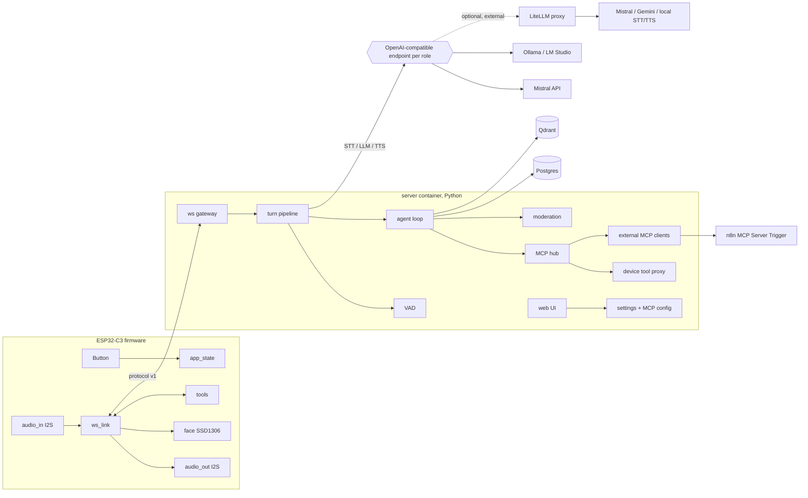
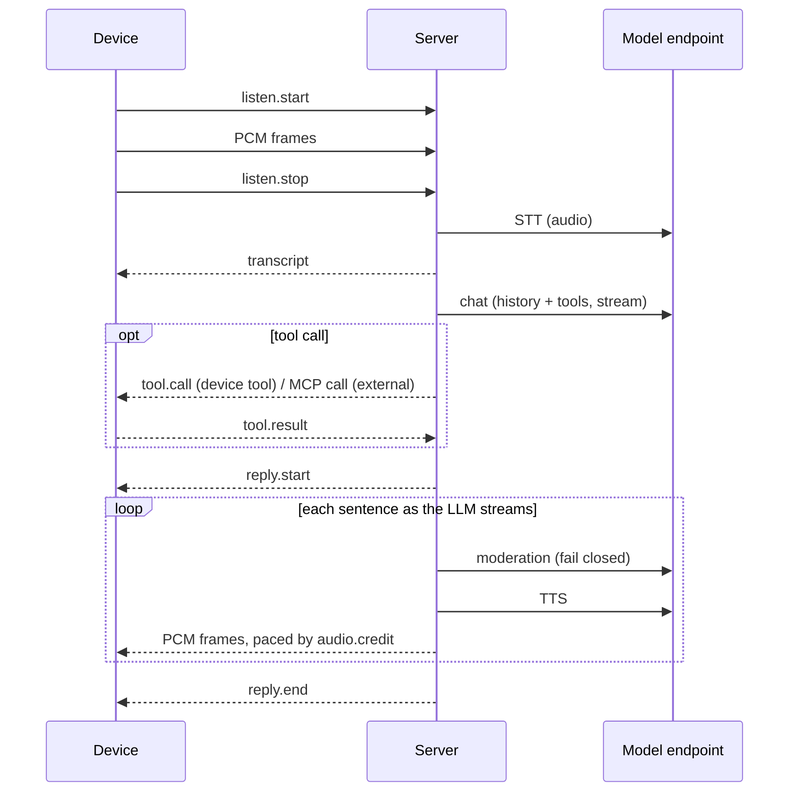

# Architecture

## Overview

## Principles
- One server instance = one device. No tenant logic. Scale by running more instances.
- The server talks only to OpenAI-compatible endpoints. Each role (chat, STT, TTS, moderation, embeddings) has its own base URL, key and model in `.env`. Unset roles use the default endpoint.
- LiteLLM is optional and runs outside this stack. Point a role at it to get provider fallback. Without it there is no fallback: a failed call ends the turn with an error code.
- The device is thin: capture audio, play audio, show a face, run hardware tools. All logic is on the server.
- No remote code update path on the device.

## Firmware modules (C, ESP-IDF 5.x)
| Module | Job |
|---|---|
| `board_pins.h` | All pin numbers in one file. |
| `provision` | SoftAP page: Wi-Fi, server URL, token. Saves to NVS. |
| `audio_in` | I2S read, 16 kHz/16-bit mono, 20 ms frames. |
| `audio_out` | I2S write, volume. |
| `ws_link` | Protocol v1 client, reconnect with backoff 1–60 s. |
| `face` | OLED faces per state. |
| `tools` | Device tools: `set_volume`, `set_face`, `get_status`. |
| `app_state` | State machine: idle, listening, thinking, speaking, offline, error. |

## Server packages (Python 3.12)
| Package | Job |
|---|---|
| `gateway` | WebSocket endpoint, auth, one session (a new connection replaces the old one), frame and time limits. |
| `pipeline` | One turn: VAD → STT → agent (streamed) → per-sentence moderation → TTS → resample to 16 kHz → paced stream. Cancel on abort. |
| `providers` | Thin OpenAI-client wrappers for STT, LLM, TTS, moderation, embeddings (base URL per role). TTS output is decoded and resampled to PCM 16 kHz s16le. A token bucket per endpoint limits the call rate; a 429 gets a short backoff, then the turn ends with `rate_limited`. |
| `agent` | Prompt, history, tool loop, 60 s speech cap, "continue". |
| `mcp_hub` | MCP client sessions; fixed device tools + external tools, namespaced; enforces `confirm`, schema hash, SSRF checks, 4 calls/turn. |
| `store` | Postgres repositories (history, settings, MCP servers, tools). Qdrant memory. |
| `web` | FastAPI + Jinja + HTMX pages: status, settings, MCP servers, tools, history. |

Design patterns: Adapter (`providers`, device tool proxy as an MCP tool source), State (`app_state`, turn pipeline), Repository (`store`).

## Turn sequence

## Deployment
- `compose.yaml`: `migrate` (one-shot) and `server`. Postgres, Qdrant and n8n are external, set by URL in `.env`. Redis is not used in the MVP. LiteLLM, if used, is also external.
- More devices: copy the `server` service with its own port, `.env` and `DEVICE_ID`.
- MVP network: LAN only, `ws://` and `http://`. Public access is a later milestone (`wss://`, reverse proxy).

## Latency budget (p50 target ≤ 5 s, button release → first sound)
| Stage | Budget |
|---|---|
| Upload tail + VAD end | 0.2 s |
| STT (batch, ≤ 10 s audio) | 1.2 s |
| LLM to first sentence | 2.0 s |
| Moderation of sentence 1 | 0.5 s |
| TTS of sentence 1 + resample | 0.8 s |
| Network + device buffer | 0.3 s |
Measured per stage in M3 (`turn.latency_ms` plus stage logs).

## Device RAM budget (ESP32-C3, no PSRAM)
| Item | KB |
|---|---|
| Wi-Fi + lwIP + system (measured in M1) | ~110 |
| WebSocket client + RX/TX buffers | 12 |
| Playback jitter buffer | 12 |
| Mic capture ring (100 ms × 2) | 7 |
| I2S DMA (in + out) | 4 |
| OLED framebuffer | 1 |
| Tasks stacks | 20 |
| Free heap target | ≥ 40 |
TLS (`wss://`) adds about 35–45 KB: spike-tested in M2.

## Security
See [security.md](security.md). Summary:
- Device auth: bearer token in the WebSocket upgrade header. Constant-time compare.
- Web UI: one admin password from `.env`, session cookie. LAN only in the MVP.
- Secrets only in `.env` (git-ignored). Model API keys are in `.env`, one per role. With LiteLLM, the server holds only a LiteLLM virtual key.
- No raw audio is stored.
