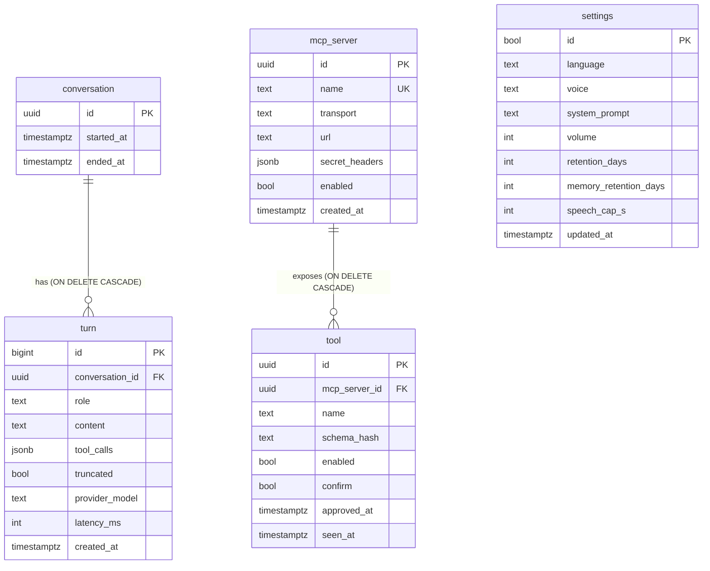

# Data model

Postgres (existing instance, version ≥ 15) and Qdrant (existing, 1.x).
OPEN: confirm the exact Postgres and Qdrant versions on the home stack.

## Isolation per instance
- `DEVICE_ID` must match `^[a-z0-9_]{1,40}$`. The server refuses to start otherwise.
- Schema `ota_<device_id>`, owned by role `ota_<device_id>`. The role has no access to other schemas. `REVOKE ALL ON SCHEMA public FROM PUBLIC`.
- Names are built in one function and quoted with `psycopg.sql.Identifier`.
- Connection: `search_path=ota_<device_id>` per connection. Pool `pool_size=2, max_overflow=3`.
  Budget: N instances × 5 ≤ `max_connections` − other users.
- Role settings: `statement_timeout=10s`, `idle_in_transaction_session_timeout=30s`.
- Qdrant: collection `ota_<device_id>_mem_<model_tag>`. Per-instance API key if the Qdrant version supports JWT RBAC; otherwise one shared key (accepted risk, documented).

## Migrations
- Alembic with `version_table_schema=ota_<device_id>`. `CREATE SCHEMA IF NOT EXISTS` first.
- Upgrade runs as a separate one-shot compose service (`migrate`) before `server`, inside `pg_advisory_lock(hashtext('ota_<device_id>'))`.
- Models have no schema names. CI checks `upgrade` and `downgrade -1`.
- The first migration seeds the built-in device `mcp_server` row and the single `settings` row.

## Tables

## Constraints (first migration)
- `uuid DEFAULT gen_random_uuid()`. `turn.id bigint GENERATED ALWAYS AS IDENTITY`.
- All timestamps `NOT NULL DEFAULT now()` (except `ended_at`, `approved_at`).
- `turn.role NOT NULL CHECK (role IN ('user','assistant','tool'))`. `CHECK (content IS NOT NULL OR tool_calls IS NOT NULL)`. `latency_ms >= 0`.
- `conversation`: `CHECK (ended_at IS NULL OR ended_at >= started_at)`.
- `settings`: single row, `id boolean PRIMARY KEY DEFAULT true CHECK (id)`.
  `language CHECK (language IN ('en','pl','uk'))`, `volume 0..100`,
  `retention_days 1..3650 DEFAULT 90`, `memory_retention_days 1..3650 DEFAULT 365`, `speech_cap_s 5..600 DEFAULT 60`.
  New settings arrive by migration.
- `mcp_server.transport CHECK (transport IN ('device','stdio','sse','streamable_http'))`.
  `CHECK ((transport='device') = (url IS NULL))`. Unique partial index: only one `device` row.
- `secret_headers` = `{ "Header-Name": "MCP_SECRET_<NAME>" }`, `CHECK (jsonb_typeof(secret_headers)='object')`.
  Values must be env names with the `MCP_SECRET_` prefix. Secret values never enter Postgres.
- `tool`: unique `(mcp_server_id, name)`. New tools: `enabled=false`, `confirm=true`. `schema_hash` change → `enabled=false`, re-approval in UI.
- Indexes: `turn (conversation_id, id)`, `conversation (coalesce(ended_at, started_at))`.

## Retention and deletion
- Daily job deletes **whole conversations** where `coalesce(ended_at, started_at) < now() - retention_days`, in batches of 500. Turns go by cascade.
- Same job deletes Qdrant points with `created_at < now() - memory_retention_days` (payload index on `created_at`).
- `source_turn_id` in Qdrant payload is display-only; it may point to a deleted turn.
- UI action "Forget everything": truncates history tables and deletes the collection, after the admin password.
- Tools not seen for 30 days are shown as stale; the admin deletes them.

## Memory (Qdrant)
- Facts only from **user** turns, never from tool output.
- One pinned embedding model, no fallback in LiteLLM. Collection name carries the model tag. Startup checks `dim` and model against a `memory_meta` row; mismatch → memory disabled, UI warning. Reindex script for a model change.

## Redis
Not used in the MVP. Pending "continue" text and confirm state live in server memory (one device per instance). Removed from required services.

## Backup
- Nightly `pg_dump -n ota_<device_id> -Fc`, then a Qdrant snapshot of the collection. RPO 24 h. RTO target 1 h.
- `pg_dump -n` before each migration.
- Monthly restore test into a scratch schema and collection.
